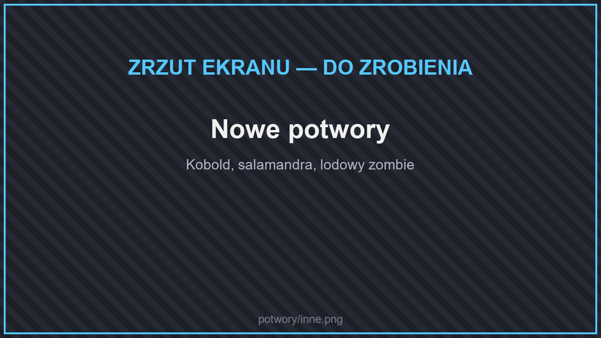
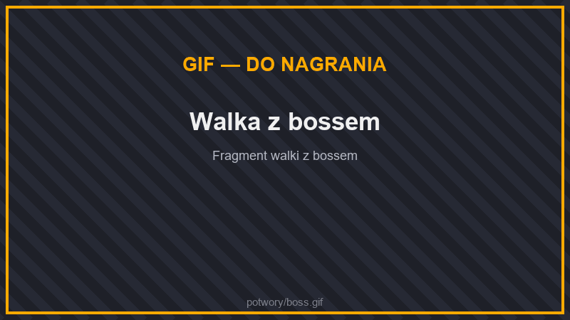

# 🧟 Potwory

Oprócz zwykłych potworów spotkasz w świecie nowe, silniejsze odmiany i zupełnie nowe stwory. Każdy biom ma własny zestaw — w górach spotkasz inne potwory niż na bagnach czy w jaskiniach. Część zwykłych potworów zostaje, więc nadal trafisz też na zwykłe zombie i szkielety.

## Szkielety

<figure><figcaption>
Szkielety
</figcaption></figure>

| Potwór | |
| --- | --- |
| Szkielet | Odmieniony szkielet. |
| Elitarny Szkielet | Rzadki, silniejszy szkielet. |
| Trujący Szkielet | Zatruwa swoimi strzałami. |
| Witherowy Szkielet | Nakłada efekt uschnięcia. Najczęściej na pustyniach i w badlandach. |
| Sculkowy szkielet | Szkielet pokryty sculkiem — w mrocznych głębinach. |
| Szkieletowy Osiłek | Silny szkielet z jaskiń. |

## Zombie

| Potwór | |
| --- | --- |
| Wzmocniony Zombie | Wytrzymalszy zombie. |
| Gigantyczny Zombie | Rzadki, ogromny zombie. |
| Nieznajomy w Płaszczu | Rzadki, dziwny przybysz. |
| Kurczakowy Dżokej | Zombie jadący na kurczaku. |
| Lodowy Zombie | Lodowa odmiana zombie z zimnych biomów. |
| Nieumarły Górnik | Zombie-górnik z jaskiń. |

## Creepery i endermany

Prawie każdy rodzaj biomu ma własnego creepera i endermana w swoich barwach, np. **Pustynny Creeper**, **Bagienny Creeper**, **Śnieżny Creeper**, **Jaskiniowy Creeper**, **Pustynny Enderman**, **Oceaniczny Enderman** czy **Enderman z Kwiecistych Pól**. Czasem trafisz też na świąteczne creepery: **Świąteczny**, **Halloweenowy** i **na Dzień Świętego Patryka**.

## Pająki

| Potwór | Gdzie |
| --- | --- |
| Bujny Pająk | dżungle i bujne jaskinie |
| lodowy pająk | zimne biomy |
| pustynny pająk | pustynie, badlandy i sawanny |
| czaszkowy pająk, czarny pająk, małe pająki | cały świat |

## Inne potwory

<figure><figcaption>
Nowe potwory
</figcaption></figure>

| Potwór | Gdzie | |
| --- | --- | --- |
| Kobold Wojownik i Kobold Łucznik | lasy | Małe stworzenia walczące wręcz i z łuku. |
| Salamandra | lasy i łąki | Ognista jaszczurka. |
| Lawowa Salamandra | jaskinie naciekowe, siarkowe i ogniste | Ognista jaszczurka z głębin. |
| Roślinny Potwór | dżungle, bagna, mroczne lasy, bujne jaskinie | Mięsożerna roślina. |
| Mimik i Ślimak | mroczne lasy (ślimak także inne lasy) | |
| Zjawa | mroczne i zimne lasy, lodowe szczyty | Upiorny przeciwnik. |
| Lodomanta | zimne biomy | Lodowy czarownik. |
| Kamienny Golem i Kamienny Sługa | góry i klify | |
| Wielki Głód | bagna | |
| Aligator | rzeki i bagna | |
| Krab, Krab Pustelnik | plaże | |
| Sowa | cały świat nocą | Zastępuje część fantomów. |
| Ametystowy Golem, Plujący Krzew | bujne jaskinie | |
| Jaskiniowy Łowca | jaskinie | |
| Krasnolud Górnik | głęboko pod ziemią | Rzadki. |
| Lawowa Kałamarnica | lawa głęboko pod ziemią | |
| mroczna dusza | mroczne głębiny | Rzadki, latający duch. |
| Golem Doświadczenia | cały świat | Bardzo rzadki golem — po pokonaniu daje dużo doświadczenia. |

## Potwory z nowych biomów

| Potwór | Gdzie |
| --- | --- |
| Pustynny Piaskun | Pustynie i badlandy — wiruje w piaskowej burzy. |
| Szkieletowy Pirat | Głębokie oceany. |

Uważaj też na duże [zwierzęta](zwierzeta.md): niedźwiedź grizzly, tygrys, krokodyl, słoń i nosorożec bronią się, gdy je zaatakujesz.

## Burze

Bardzo rzadko po świecie wędruje żywa burza: **Burza** na łąkach podczas burzy, **Burza Piaskowa** na pustyni, **Śnieżyca** w śnieżnych biomach i **Wodna Burza** nad oceanem.

## Bossowie

<figure><figcaption>
Walka z bossem
</figcaption></figure>

Bossów spotkasz w lochach i strukturach rozsianych po świecie, np. w Fabrykach Golemów. Zobacz też [Boss tygodnia](../../informacje/osiagniecia.md#boss-tygodnia).

## Piniata

Piniata pojawia się, gdy gracze zagłosują na serwer. Rozbijcie ją razem, aby zdobyć odłamki kluczy i nagrody.
