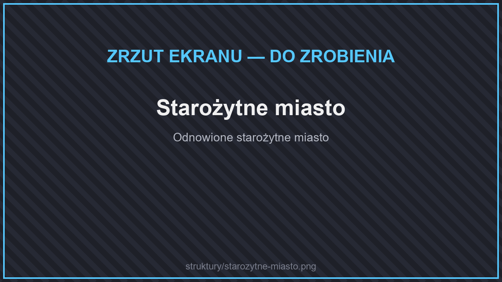
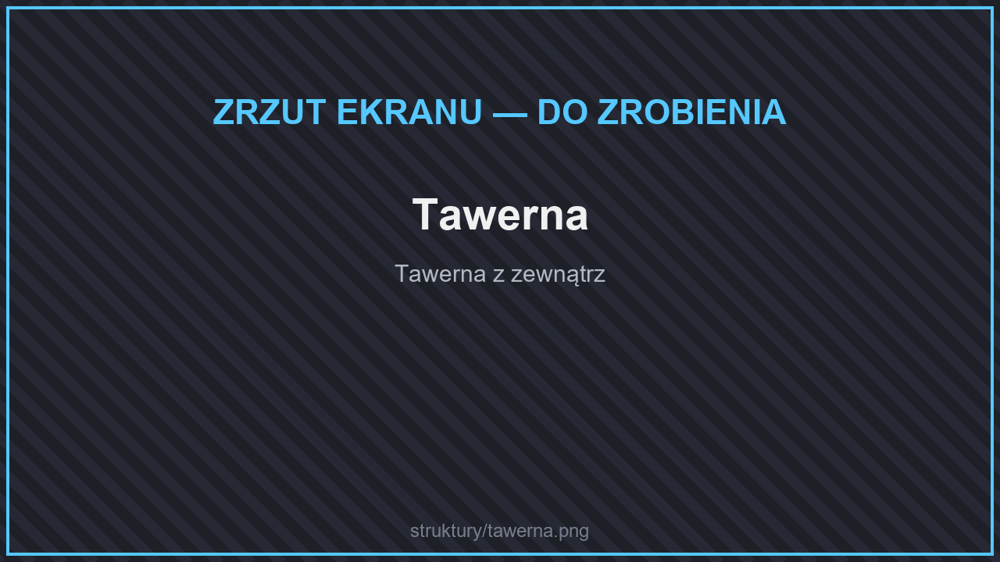
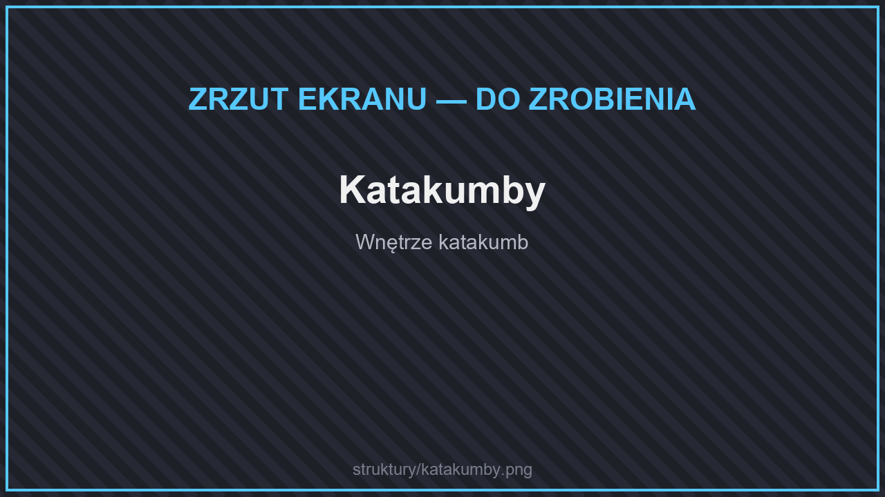
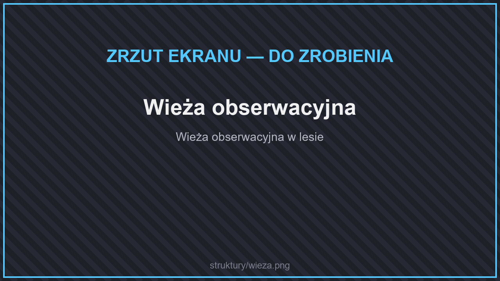

# 🏰 Struktury

Świat jest pełen nowych budowli do odkrycia. Wiele z nich ma skrzynie z łupami, a niektóre strzegą potwory.

## Odnowione struktury

<figure><figcaption>
Starożytne miasto
</figcaption></figure>

Zwykłe struktury Minecrafta zostały przebudowane i są większe oraz ciekawsze:

* **Starożytne miasto**, **twierdza (stronghold)**, **monument oceaniczny**, **dwór w lesie**,
* **piramida pustynna**, **świątynia w dżungli**, **chatka czarownicy**, **posterunek złosadników**,
* **kopalnie** — w wersjach dla różnych biomów (z każdego drewna, kamienne, łupkowe, błotne, bujne, naciekowe),
* **zniszczone portale**, **wraki statków** i **podwodne ruiny** (w tym podwodne miasto).

## Nowe struktury

<figure><figcaption>
Tawerna
</figcaption></figure>

<figure><figcaption>
Katakumby
</figcaption></figure>

<figure><figcaption>
Wieża obserwacyjna
</figcaption></figure>

* **Tawerny** i małe osady, w tym wioski ufortyfikowane.
* **Lochy i krypty:** katakumby, pełzająca krypta, komnaty w jaskiniach, bunkry, pokoje potworów.
* **Złosadnicy:** koszary, obozy, kryjówki i dwory złosadników.
* **Wieże:** wieże obserwacyjne (w każdym rodzaju drewna), wieże magów (w czterech porach roku), wieża czarodzieja, latarnie morskie, wieża inżyniera.
* **Ruiny** w lasach, dżunglach, tajdze, na pustyniach i bagnach.
* **Posterunki i obozy:** obóz górników, obozowiska, skrytki z zapasami, drogowskazy, farmy.
* **Podziemne:** gigantyczny ul, mroźny loch, stara rafineria, zatopiona wieża, podziemne chatki.
* **Inne:** mauzolea, cmentarze, kaplice, stare dwory, świątynie, wielki muchomor i wiele więcej.


W skrzyniach w strukturach możesz znaleźć runy i rzadkie przedmioty.

