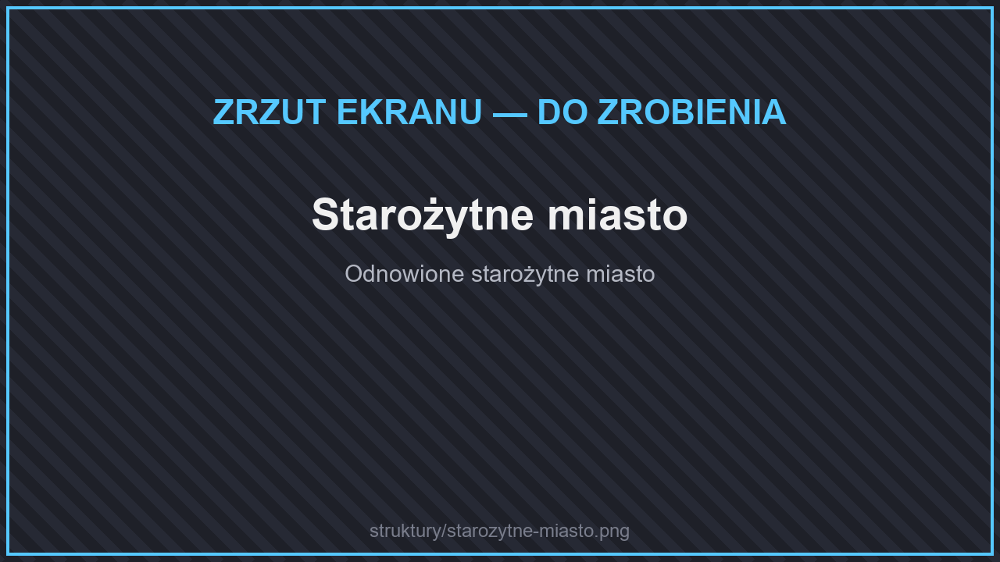
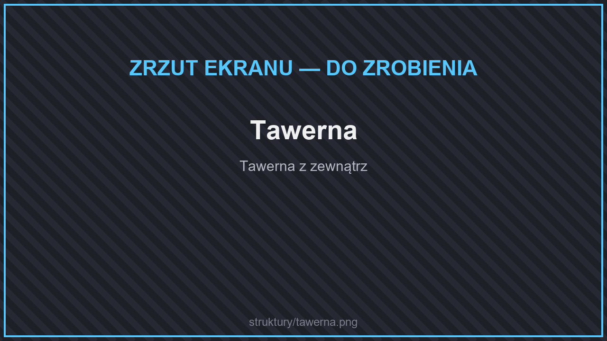
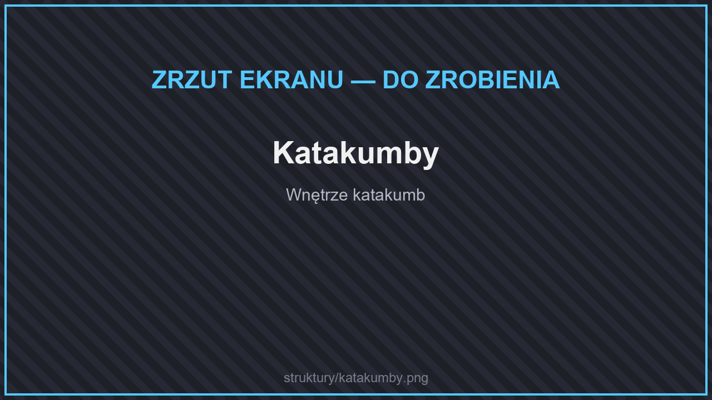
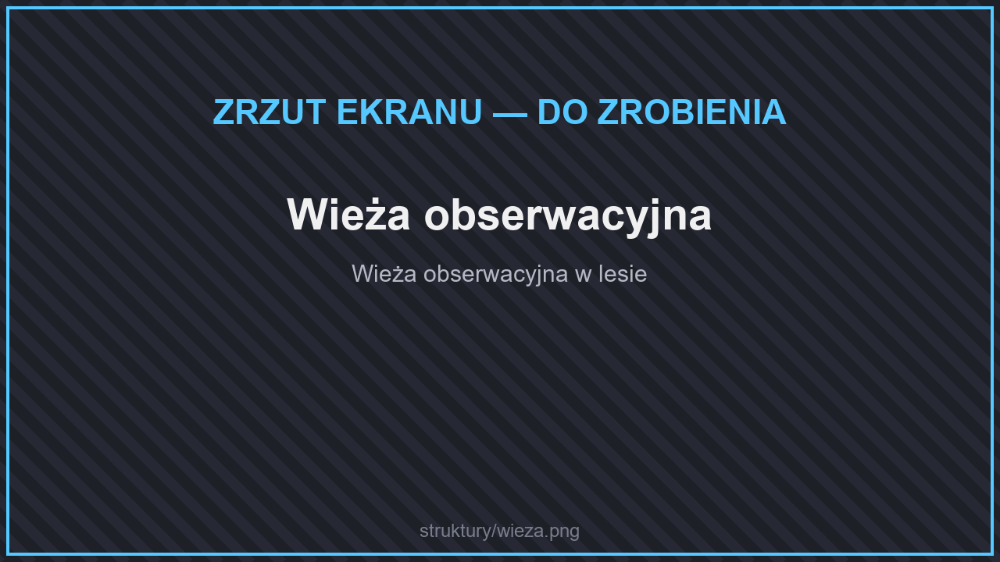

# 🏰 Struktury

Świat jest pełen nowych budowli do odkrycia. Wiele z nich ma skrzynie z łupami, a niektóre strzegą potwory. Budowle omijają strome urwiska i wodę, więc rzadko trafisz na dom zawieszony nad przepaścią albo stojący w morzu.

## Odnowione struktury

<figure><figcaption>
Starożytne miasto
</figcaption></figure>

Zwykłe struktury Minecrafta zostały przebudowane i są większe oraz ciekawsze:

* **Starożytne miasto**, **twierdza (stronghold)**, **monument oceaniczny**, **dwór w lesie**,
* **piramida pustynna**, **świątynia w dżungli**, **chatka czarownicy**, **posterunek złosadników**,
* **wioski** — nowe wersje: równinne, pustynne, sawannowe, śnieżne, w tajdze i w gajach wiśniowych, a także brzozowe i bagienne,
* **kopalnie** — w wersjach dla różnych biomów (z każdego drewna, kamienne, łupkowe, błotne, bujne, naciekowe, a także w szczytach gór i badlandach),
* **zniszczone portale**, **wraki statków** i **podwodne ruiny** (w tym podwodne miasto).

## Nowe struktury

<figure><figcaption>
Tawerna
</figcaption></figure>

<figure><figcaption>
Katakumby
</figcaption></figure>

<figure><figcaption>
Wieża obserwacyjna
</figcaption></figure>

* **Tawerny** w wielu biomach, małe osady, chaty, farmy i studnie.
* **Lochy i krypty:** katakumby, pełzająca krypta, krypty nieumarłych, komnaty w jaskiniach, bunkry, pokoje potworów.
* **Złosadnicy:** koszary, obozy, kryjówki i rezydencje złosadników.
* **Wieże:** wieże obserwacyjne (w wielu rodzajach drewna), latarnie morskie, wieża inżyniera, wieża czarownicy.
* **Zamki i forty:** zamki, forty i cytadele — także w śnieżnych biomach.
* **Ruiny** w lasach, dżunglach, tajdze, na pustyniach i bagnach.
* **Posterunki i obozy:** obóz górników, obozowiska, skrytki z zapasami, drogowskazy, farmy.
* **Podziemne:** podziemne chatki i domy, obozy w łupku, lochy prób.
* **Na morzu:** wyspy z chatkami, statki, platformy złosadników.
* **Inne:** mauzolea, cmentarze, kaplice, stare dwory, świątynie, kapliczki, wielki muchomor i wiele więcej.

### Gdzie szukać

Część struktur stoi tylko w kilku [biomach](biomy.md):

| Struktura | Biomy |
| --- | --- |
| **Wioska w dżungli** | Sparse Rainforest, Tropics |
| **Wioska bagienna** | Bayou, Fen |
| **Rezydencja złosadników** | Old Growth Boreal Taiga, Old Growth Golden Boreal Taiga, Blackwood Taiga |
| **Posterunek złosadników w dżungli** | Rainforest, Sparse Rainforest, Tropics |
| **Wieża obserwacyjna** (leśna) | Flower Forest, Deciduous Forest, Alpha Grove |
| **Wieża obserwacyjna** (bagienna) | Bayou, Fen, Marsh |
| **Wieża czarownicy** | Boreal Taiga, Golden Boreal Taiga, Cold Boreal Taiga, Pine Slopes, Cold Deciduous Forest |
| **Świątynia świętej relikwii** | Sparse Rainforest |
| **Skrytka z zapasami** (dżunglowa) | Rainforest, Sparse Rainforest, Tropics |
| **Skrytka z zapasami** (tajgowa) | Boreal Taiga, Golden Boreal Taiga, Old Growth Boreal Taiga, Old Growth Golden Boreal Taiga, Pine Taiga, Cold Boreal Taiga, Frozen Pine Taiga |
| **Koszary złosadników** | Sunflower Plains, Grassland, Prairie |
| **Placówka w tajdze** | Grove, Boreal Taiga, Pine Taiga, Cold Boreal Taiga |
| **Placówka w dżungli** | Bamboo Jungle, Rainforest, Sparse Rainforest |
| **Placówka zbieraczy** | Dark Forest, Old Growth Bayou, Old Growth Boreal Taiga, Old Growth Golden Boreal Taiga, Blackwood Taiga |
| **Ruiny w dżungli** | Bamboo Jungle, Rainforest, Sparse Rainforest, Tropics |
| **Ruiny szlaku** | Old Growth Birch Forest, Boreal Taiga, Cold Boreal Taiga, Old Growth Boreal Taiga, Redwoods, Rainforest |
| **Wieża przeciwpożarowa** | Old Growth Birch Forest, Old Growth Boreal Taiga, Pine Taiga, Redwoods |
| **Stary dwór**, **ruiny w gęstym lesie** | Dark Forest, Old Growth Boreal Taiga, Old Growth Golden Boreal Taiga |
| **Opuszczona fabryka** (golemów) | Sunflower Plains, Grassland, Clover Plains |

## Fabryki golemów

Trzy rodzaje lochów z golemami — w każdej fabryce rozpoczniesz **próbę**: walczysz z kolejnymi falami przeciwników, a po wygranej czeka nagroda. Po pewnym czasie próbę można powtórzyć.

| Fabryka | Gdzie | Przeciwnicy |
| --- | --- | --- |
| **Opuszczona fabryka** | równiny ze słonecznikami, trawiaste równiny, równiny koniczyny | Fabryczny Wojownik, Fabryczny Strzelec, Fabryczny Łucznik, Fabryczny Rakietnik, Fabryczny Kolos |
| **Fabryka sculku** | mroczne głębiny | Sculkowy Wojownik, Sculkowy Strzelec, Sculkowy Kolos, Sculkowa Plaga |
| **Fabryka piglinów** | karmazynowe lasy w [Netherze](../nether/struktury.md) | Piglin Wojownik, Piglin Strzelec, Piglin Weteran, Piglin Kolos |

## Łupy w strukturach

W skrzyniach i beczkach struktur, oprócz zwykłych łupów, czasem leżą przedmioty pasujące do miejsca — [jedzenie z kuchni](../../dodatki/gotowanie.md), materiały z potworów, ryby, rudy, [Lucky Bloki](../../dodatki/lucky-bloki.md). Trafiają się rzadko i w małych ilościach — mniej więcej w co trzeciej skrzyni jeden taki przedmiot — więc skrzynie nie są nimi zapchane.

* **Karczmy** — tawerny (beczki z jedzeniem i napojami, skrzynie z zadaniami): Cydr Jabłkowy, Melonowy Sok, Gorące Kakao, Gulasz Wołowy, Rosół, Zupa Warzywna, Kanapka z Boczkiem, Hamburger, Pierogi, Miodowe Ciastko, Ciastko ze Słodkimi Jagodami; rzadko: Talerz, Mały Talerz.
* **Kuchnie i spiżarnie** — kuchnie złosadników, wiedźm i rezydencji, lodówki, spiżarnie, rzeźnicy: Cebula, Pomidor, Kapusta, Ryż, Ciasto Pszenne, Surowy Makaron, Sos Pomidorowy, Spód Ciasta, Butelka Mleka, Jajko Sadzone, Pieczona Dziczyzna, Pieczone Mięso Dzika, Pieczone Mięso Bizona, Wędzona Szynka; rzadko: Patelnia Żeliwna, Garnek.
* **Domy w wioskach** — domy mieszkalne wiosek i osad: Jajko Sadzone, Kanapka z Jajkiem, Pieczony Ryż, Zupa Warzywna, Gołąbki, Cydr Jabłkowy, Butelka Mleka, Miodowe Ciastko.
* **Garbarnie i owczarnie** — garbarze i pasterze w wioskach, pokoje z wełną: Futro Bizona, Niedźwiedzie Futro, Skóra Kangura, Ogon Szopa, Pióro Emu.
* **Farmy i ogrody** — farmy, stodoły, młyny, pola w jaskiniach, ogrody: Kapusta, Pomidor, Cebula, Ryż, Kapuściane Nasiona, Pomidorowe Nasiona, Słoma, Kompost Organiczny; rzadko: Pomidorowa Skrzynka, Kapuściana Skrzynka, Skrzynka Cebuli, Snop Ryżu.
* **Kopalnie** — kopalnie (także łupkowe i badlandowe), obozy górników, składy rudy: Topaz, Lina, Pieczony Szaszłyk Mięsny, Kanapka z Boczkiem, Kościany Pędzelek; rzadko: Lucky Blok Łupów.
* **Kuźnie i zbrojownie** — kuźnie, zbrojownie, płatnerze, łucznicy, narzędziownie: Krzemienny Nóż, Żelazny Nóż, Złoty Nóż, Topaz; rzadko: Diamentowy Nóż.
* **Lochy, krypty i cmentarze** — lochy, katakumby, krypty, groby, więzienia, cmentarze, bunkry: Fragment Skrzydła Karalucha, Larwa, Kłujka Szkarłatnego Komara, Pazur Spadającego Niedźwiedzia, Kości Palców, Połowiczna Kość, Kły; rzadko: Lucky Blok, Lucky Blok Mobów, Lucky Blok Łupów, Szkieletowy Totem Nieśmiertelności, Gnijący Totem Nieśmiertelności.
* **Twierdze (strongholdy)** — korytarze, skrzyżowania i cele twierdzy: Endowy Pył, Endowy Odłamek, Fragment Skrzydła Karalucha, Larwa, Kości Palców; rzadko: Lucky Blok Mobów.
* **Biblioteki** — biblioteki (twierdze, dwory, wieże, rezydencje): Fragmenty Historii.
* **Ruiny i świątynie** — ruiny, kapliczki, świątynie, studnie, dziwne domy: Fragmenty Historii, Kościany Pędzelek; rzadko: Lucky Blok Budowli, Lucky Blok.
* **Pustynie i badlandy** — piramidy, pustynne ruiny i świątynie, rancza, obozy bandytów: Róg Gazeli, Oko Pustynnego Piaskuna, Grzechotka Grzechotnika, Pióro Kukawki, Surowe Mięso Węża, Fragmenty Historii, Kościany Pędzelek; rzadko: Lucky Blok Budowli.
* **Dżungle i bagna** — świątynie i ruiny w dżungli, chaty na bagnach i namorzynach, obozy bagienne: Sałatka Owocowa, Melonowy Sok, Lody Melonowe, Gorące Kakao, Śluz Pomrowika Bananowego, Łuska Krokodyla, Surowe Mięso Krokodyla, Surowe Żabie Udka, Fragmenty Historii, Kościany Pędzelek; rzadko: Lucky Blok Budowli.
* **Mroźne krainy** — igloo, lodowe forty i wieże, forty i obozy tułaczy, śnieżne osady: Róg Mroźnego Łowcy, Niedźwiedzie Futro, Surowa Dziczyzna, Żeberka Łosia, Gorące Kakao; rzadko: Hełm Mroźnego Łowcy.
* **Złosadnicy** — posterunki, koszary, kryjówki, obozy i dwory złosadników: Niedźwiedzie Futro, Futro Bizona, Ogon Szopa, Żelazny Nóż; rzadko: Czapka Trapera, Lucky Blok Mobów, Wybuchowy Totem Nieśmiertelności, Teleportujący Totem Nieśmiertelności.
* **Wiedźmy i alchemicy** — chatki i wille wiedźm, toksyczne leże, wieże czarodziejów, pracownie mikstur: Mimikrem, Śluz Pomrowika Bananowego, Kłujka Szkarłatnego Komara, Larwa, Tran, Napar z Rogu Gazeli; rzadko: Mackowaty Totem Nieśmiertelności, Żądlący Totem Nieśmiertelności.
* **Morze i wraki** — wraki statków, podwodne ruiny i miasto, monumenty, zakopane skarby, latarnie, wyspy: Ogon Homara, Blobfisz, Latająca Ryba, Tran, Ości, Surowe Mięso Rekina, Perła, Muszla, ryby z wędkarstwa (Makrela, Tuńczyk, Barakuda i inne); rzadko: Kryształ Głębin, Pułapka na Ryby.
* **Rybacy** — chaty rybaków, przystanie, łowiska w jaskiniach i fortach: ryby z wędkarstwa (Tęczowy Pstrąg, Okoń, Szczupak i inne), Surowy Sum, Ości, Tran; rzadko: Pułapka na Ryby.
* **Kupcy i karawany** — punkty handlowe, wędrowni handlarze, namioty, wieże kupców i koczowników: Skóra Kangura, Róg Gazeli, Ogon Szopa, Łuska Krokodyla, Pióro Emu, Cydr Jabłkowy, Melonowy Sok, Sałatka Owocowa, Lody Melonowe; rzadko: Marakas.
* **Obozy, forty i wieże** — obozowiska, skrytki z zapasami, wieże, forty, zamki, cytadele, chaty, dwory: Kanapka z Boczkiem, Pieczony Szaszłyk Mięsny, Pieczona Dziczyzna, Pieczone Mięso Dzika, Pieczone Mięso Bizona, Cydr Jabłkowy, Lina, Krzemienny Nóż; rzadko: Lucky Blok.
* **Starożytne miasta** — starożytne miasta i ich skrytki (mroczne głębiny): Sculkowa Macka, Sculkowy Korzeń, Sculkowy Krzak, ryby z wędkarstwa (Echopłetwy Lucjan), Topaz; rzadko: Ostateczny Lucky Blok.
* **Komnaty prób** — korytarze i zapasy komnat prób (nie nagrody ze skarbców): Oko Pustynnego Piaskuna, Pieczony Szaszłyk Mięsny.
* **Fabryki golemów** — opuszczona fabryka, fabryka sculku, fabryka piglinów: Miedziane Koło Zębate, Żelazne Koło Zębate, Koło Zębate z Czerwonego Kamienia, Lazurytowe Koło Zębate, Złote Koło Zębate; rzadko: Lucky Blok Mobów.
* **Zniszczone portale** — zniszczone portale (Świat Główny i Nether): Bryła Magmy, Surowy Wulkanit.


W skrzyniach w strukturach możesz znaleźć też runy i rzadkie przedmioty.

