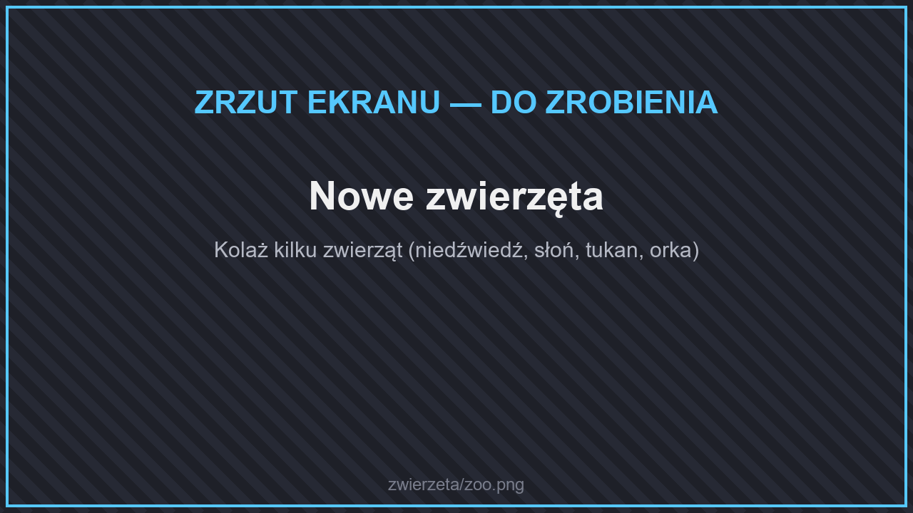
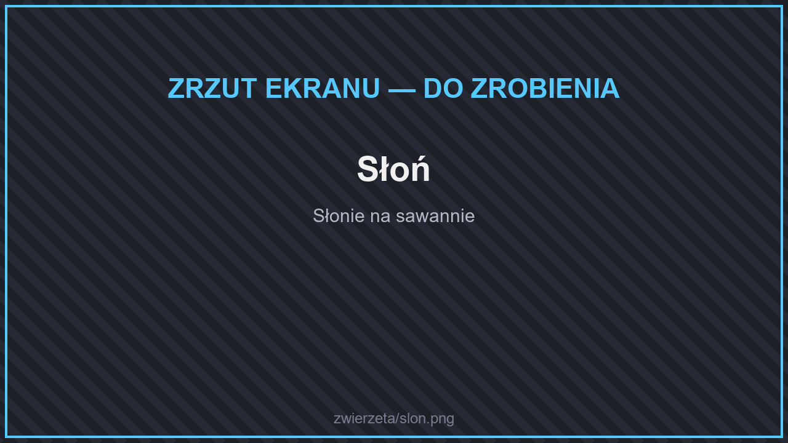
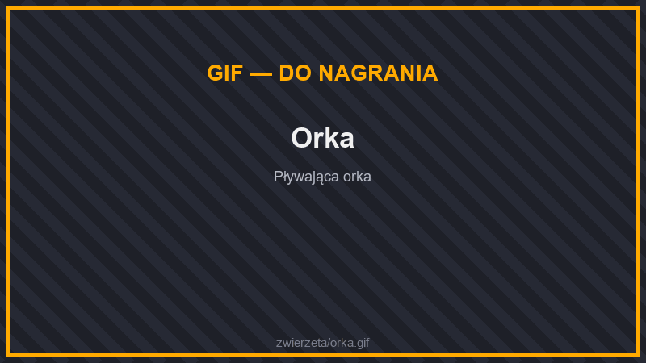

# 🐄 Zwierzęta

<figure><figcaption>
Nowe zwierzęta
</figcaption></figure>

W świecie żyje kilkadziesiąt nowych zwierząt. Każde ma swoje ulubione biomy. Część jest **neutralna** — zaatakowana, broni się (np. niedźwiedź, słoń, nosorożec, goryl). Z wielu wypada [nowe mięso](../../dodatki/gotowanie.md#mieso-z-dzikich-zwierzat).

## Lasy i tajgi

<figure><figcaption>
Niedźwiedź Grizzly
</figcaption></figure>

| Zwierzę | Gdzie | Wypada |
| --- | --- | --- |
| **Niedźwiedź Grizzly** | lasy, tajgi | niedźwiedzina |
| **Szop** | lasy i równiny | |
| **Skunks** | lasy | |
| **Diabeł Tasmański** | lasy | |
| **Wiewiórka**, **sowa**, **mały ptak** | lasy | |
| **Wrona**, **Modrosójka niebieska** | lasy | pióra |
| **Lotopałanka** | lasy brzozowe | |
| **Nocolot** | ciemny las | pióra |
| **Bielik Amerykański** | gaje, wietrzne lasy | pióra |
| **Aliolimax** (wielki ślimak) | stare tajgi | |
| **Łoś** | śnieżna tajga | żeberka łosia |

## Łąki, góry i równiny

| Zwierzę | Gdzie | Wypada |
| --- | --- | --- |
| **Bizon** | równiny, łąki, prerie | bizonina |
| **Dżelada Brunatna** | łąki | |
| **Koliber** | kwieciste biomy, dżungle | |
| **Słoneczny Ptak** | szczyty gór | |

## Sawanny, pustynie i badlandy

<figure><figcaption>
Słoń
</figcaption></figure>

| Zwierzę | Gdzie | Wypada |
| --- | --- | --- |
| **Słoń**, **Nosorożec** | sawanny | |
| **Gazela** | sawanny | dziczyzna |
| **Pompasowiec Grzywiasty** | sawanny | |
| **Kangur** | sawanny, badlandy, outback | mięso kangura |
| **Emu**, **Kukawka** | sawanny, badlandy | pióra, udko emu |
| **Grzechotnik** | pustynie, badlandy | mięso węża |
| **Skoczek Pustynny**, **Podeszczowik Pustynny** | pustynie | żabie udka (podeszczowik) |
| **Przekopnica** | sadzawki na pustyni | |
| **Kameleon**, **ropucha rogata**, **sęp**, **pyłowy diabeł**, **kaktusik** | pustynie | |

## Dżungle

<figure><figcaption>
Goryl
</figcaption></figure>

| Zwierzę | Gdzie | Wypada |
| --- | --- | --- |
| **Goryl** | dżungle, lasy deszczowe | |
| **Kapucynka** | dżungle | |
| **Tukan** | dżungle | pióra |
| **Mrówkojad** | dżungle | |
| **Waran** | rzadkie dżungle, lasy eukaliptusowe | mięso krokodyla |
| **Tygrys** | bambusowe dżungle, gaje wiśniowe | |

## Zimne biomy

| Zwierzę | Gdzie | Wypada |
| --- | --- | --- |
| **Irbis Śnieżny** | śnieżne biomy | |
| **Tusklin** | lodowe kolce | dzik |
| **Mroźny Łowca** | lodowe szczyty | |

## Bagna i rzeki

<figure><figcaption>
Krokodyl
</figcaption></figure>

| Zwierzę | Gdzie | Wypada |
| --- | --- | --- |
| **Krokodyl** | rzeki, bagna | mięso krokodyla |
| **Kajman** | bagna namorzynowe | mięso krokodyla |
| **Skorpucha Sępia** (żółw jaszczurowaty) | bagna | mięso żółwia |
| **Żółw Diamentowy** | rzeki | mięso żółwia |
| **Trzewikodziób** | bagna | pióra, udko |
| **Dziobak** | rzeki | |
| **Sum** | rzeki, bagna | sum |
| **Poskoczek mułowy** | bagna namorzynowe | |

## Grzybowe pola

| Zwierzę | Wypada |
| --- | --- |
| **Króligrzyb** | czerwone grzyby |
| **Mungus** | |

## Plaże i morza

<figure><figcaption>
Orka
</figcaption></figure>

| Zwierzę | Gdzie | Wypada |
| --- | --- | --- |
| **Mewa** | plaże | pióra |
| **Foka** | plaże, zimne oceany | |
| **Homar** | plaże | ogon homara |
| **Orka**, **Kaszalot** | oceany | |
| **Kałamarnica Olbrzymia** | głębokie oceany | torbiele z atramentem |
| **Rekin Młot** | ciepłe oceany | mięso rekina |
| **Płaszczak** (rekin) | głębokie oceany | mięso rekina |
| **Ustonog**, **Kopiująca Ośmiornica** | ciepłe oceany | |
| **Blobfisz** | głębokie oceany | blobfisz |
| **Latająca Ryba** | oceany, rafy | latająca ryba |

## Jaskinie

<figure><figcaption>
Trzepotnik
</figcaption></figure>

| Zwierzę | Gdzie | Wypada |
| --- | --- | --- |
| **Trzepotnik** | bujne jaskinie | kwiat zarodników |
| **Kamienny Pancernik** | jaskinie naciekowe | tuf, nacieki |
| **Karaluch**, **Mucha** | wszędzie | larwy (mucha) |

## Owady

W świecie żyją też owady: motyle, ćmy Atlas, świetliki, biedronki, modliszki, żuki gnojowe, ślimaki, tarantule, skarabeusze i mrowiska. Możesz je łapać siatką — zobacz [Insekty](../../dodatki/insekty.md).


Zwierzęta z Netheru i Kresu opisują strony [potworów Netheru](../nether/potwory.md) i [potworów Kresu](../kres/potwory.md).

